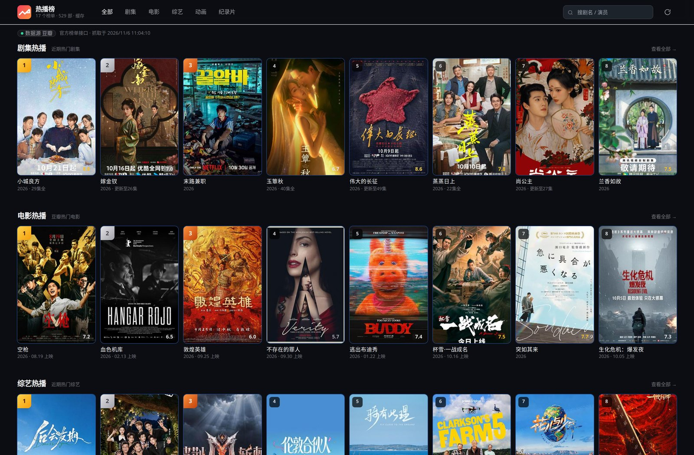
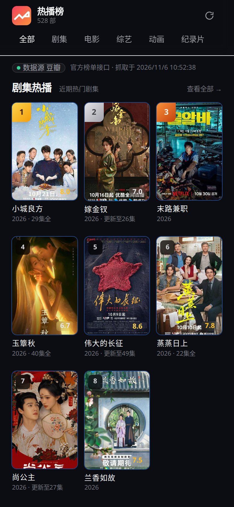
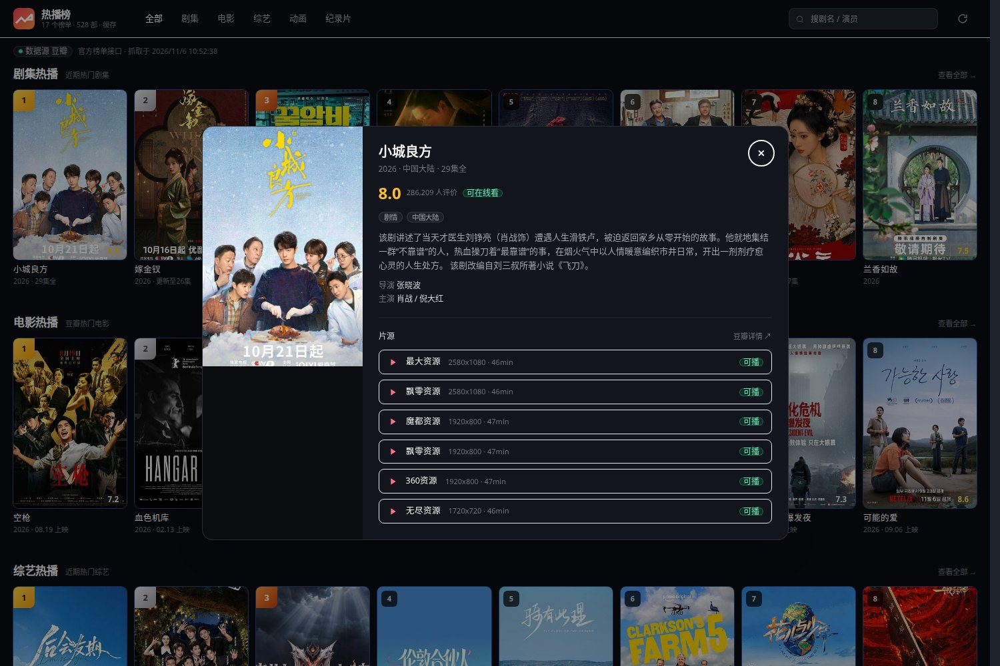

# 看看 · Kankan

<p>
  
  
  
  
</p>

一个装进电视盒子的影视热播榜客户端：首页是豆瓣 17 个榜单合并而成的海报墙，点开一部片，
它会并行去十几个资源站检索、拆线路、拆集数、真取一次 m3u8 探活，按历史成功率排好序等你按 OK；
播放时每 5 秒落一次进度，退出再进来直接回到上次那一集那一秒。

配套一个零第三方依赖的 Node 采集器，把资源站的差异配置化，并额外提供一套能直接在浏览器里看的海报墙。

> 片源全部来自第三方采集站的公开接口，**仅作技术验证**，详见文末「合规」。

---

## 截图

以下界面来自配套采集器自带的网页海报墙（`vod-collector/web`），与 TV 端共用同一批榜单数据与源清单；
TV 端为 Android 原生界面，暂无公开截图（构建环境跑不动模拟器，界面未录制）。

| 桌面端海报墙 | 手机端 |
|---|---|
|  |  |

点开海报后的详情弹窗：豆瓣评分与简介 + 多站片源列表，每条都带分辨率、时长和「可播」探活结果。
排序用的是每个源的历史成功率与响应速度，不是简单的配置顺序。



---

## 由三部分组成

| 目录 | 技术 | 作用 | 必需 |
|---|---|---|---|
| `vod-tv/` | Java 8 + Android 原生 View + ExoPlayer | TV/手机客户端，最终产出 APK | 是 |
| `vod-collector/` | Node.js 18+，零第三方依赖 | 采集器 + 榜单服务 + 网页海报墙（端口 8765） | 否，可直连 |
| `tools/` | Python | 图标管线（Material 图标抓取/光栅化）、构建产物与 id 类型自检 | 开发用 |

客户端两种模式：默认**直连**豆瓣与各资源站，不需要任何服务器；在设置页填了服务端地址后，
榜单、海报、源清单全部走自建服务，改逻辑不用重新发版。

```
┌──────────────────────────┐
│  vod-tv（Android 4.4+）  │──── 直连 ────▶ 豆瓣 / 各资源站
│  手写焦点 · ExoPlayer    │
└───────────┬──────────────┘
            │ 可选 HTTP
┌───────────▼──────────────┐
│  vod-collector（:8765）  │────▶ 23 个资源站 / 豆瓣 17 榜
│  /api/rank /search /poster│
└──────────────────────────┘
```

---

## 功能

**TV 客户端**

- 首页三个 tab：豆瓣热榜（17 榜全量合并去重）、新品速递、找一找（类型 / 年份 / 排序三组筛选 + 滚动自动翻页）
- 多源并行检索：每站按片名匹配打分挑最佳条目，自动剔除「解说 / 预告 / 花絮 / 混剪」这类条目
- 源稳定性排序：成功率 + 响应速度打分，用得越久越准；详情页可逐条启停、锁定、恢复默认、从服务端同步
- 续播：每 5 秒落盘一次，记录页点一张卡就开始准备续播，不用先进详情页再按一次
- 选集折叠：≥50 集按 10 集一组分组，当前集打勾，浮层里默认展开正在播的那组
- 播放页长按连续快进/快退（遥控器 ← →、手机左右半屏），松手即停
- 全程遥控器可操作：显式焦点链、统一 2dp 焦点描边 + 1.06 放大，不为 TV 引入 Leanback

**采集器**

- 23 个资源站配置化（`config/stations.json`）：接口参数完全同构，差异只有路径变体、搜索开关、域名漂移
- `node src/cli.js health | search | detail | play | chart` 命令行直接验证链路
- 自算热度榜（备用）、豆瓣 17 榜拉取、海报代理（带磁盘缓存与 SSRF 白名单）

---

## 快速开始

**构建 APK**（需要 JDK 17 + Android SDK platform 33）

```bash
cd vod-tv
echo "sdk.dir=/path/to/Android/Sdk" > local.properties   # Windows 用双反斜杠
./gradlew clean assembleDebug
adb install -r app/build/outputs/apk/debug/app-debug.apk
```

**跑采集器**（需要 Node 18+，无需 `npm install`）

```bash
cd vod-collector
npm start                       # node src/server.js 8765
node src/cli.js health          # 23 站存活检查
node src/cli.js search 空枪 --resolve
```

浏览器打开 `http://localhost:8765` 就是海报墙。客户端设置页填 `http://<电脑内网IP>:8765`
即可切到服务端模式（电视与电脑需在同一局域网，不能填 localhost）。

---

## 几个值得一看的设计

**源不会永远按配置顺序排。** 每次检索都记一次成功/失败与耗时，打分用拉普拉斯平滑：

```
成功率 = (成功 + 1) / (总次数 + 2)
速度分 = 1 - min(平均耗时, 6000) / 6000
得分   = 成功率 × 0.75 + 速度分 × 0.25 + priority × 0.01
```

平滑的意义：只成功过一次的源不会因为 `1/1 = 100%` 被顶到第一位。

**续播是三级降级，不是一次跳转。** 当天检测过 → 直接取缓存线路；没检测过 → 重新检索（遮罩会写文案，
不然用户以为卡死）；还是拿不到流 → 进详情页，详情页检索完自己续播。全程有 `opening` 标志挡重复点击。

**源检测按自然日缓存。** 一部剧的检测结果几十 KB，塞进 SharedPreferences 会拖慢每次读配置，
所以按片名 MD5 落到 `filesDir/playcache/`，跨天失效，60 个文件按时间淘汰，一个可播源都没有时不写缓存
（避免把昨天还能用的结果盖掉）。

**`vod_play_url` 是三级结构，不是两级。**

```
第01集$https://a.com/share/xxx#第02集$...   ← 线路 1（分享页，要二次解析）
$$$                                          ← 线路分隔
第01集$https://a.com/xx/index.m3u8#...       ← 线路 2（直链）
```

只按 `#` 拆会把两条线路的 91 条当成 91 集、集号重复。现在的策略是选**直链占比最高**的那条线路：
《庆余年》第一季实测 91 条 → 46 集、集名无重复、全直链。

**minSdk 19 的代价与收获。** 为了老盒子把门槛压到 Android 4.4：ExoPlayer 停在最后一个 2.x（2.19.1，
再往上要 API 21），圆角只能自己用 `clipPath` 画（`setClipToOutline` 是 API 21），TV 焦点全手写
（Leanback 当年被排除）。换来的是一套只有两个依赖的工程，UI 全部自己搭。代价是 `lintDebug` 的
`NewApi` 必须为 0 —— 这是 4.4 兼容唯一的自动化保障。

---

## 工程结构

```
vod-tv/app/src/main/java/com/vodtv/
├── App.java                  入口：给 4.x 强开 TLS 1.2、初始化各存储、崩溃捕获
├── data/
│   ├── RankRepository.java   榜单：豆瓣双接口直连 / 服务端 / 磁盘缓存 / 新品速递 / 找一找
│   ├── PlayResolver.java     搜片 → 挑最佳条目 → 拆线路分集 → 解析 m3u8 → 探活 → 排序
│   ├── PlayCache.java        源检测结果按自然日缓存
│   ├── ResumeHelper.java     续播三级降级（记录页与所有续播入口共用）
│   ├── SourceStats.java      成功率统计与打分
│   └── HistoryStore.java     播放进度 + 已看完推导
├── ui/                       首页 / 详情 / 搜索 / 记录 / 设置
├── player/PlayerActivity.java
└── widget/                   圆角图、FocusKit（统一焦点实现）

vod-collector/
├── config/stations.json      ⭐ 23 个资源站配置（唯一需要改的地方）
├── src/maccms.js             苹果 CMS 适配层
├── src/hls.js                master 递归 / AES-128 / 分享页二次解析
├── src/douban.js             豆瓣 17 榜 + 双结构归一化
└── src/server.js             HTTP 服务
```

---

## 文档

| 文件 | 内容 |
|---|---|
| [`PROJECT.md`](PROJECT.md) | 项目全貌：数据流、接口、数据结构、算法、视觉规范、技术选型理由 |
| [`PITFALLS.md`](PITFALLS.md) | 踩坑清单 P-01 ~ P-14：构建工具链、4.4 兼容、接口、TV 焦点、图标管线 |

两份文档都是自包含的，改动前建议先读一遍对应章节。

---

## 已知限制

- **未做大规模真机验证**：布局按 1080p / 6 列推算，装到具体盒子上可能要微调间距
- **榜单依赖豆瓣私有接口**：没有公开承诺，变了要发版；服务端模式可以兜底
- **片源高度重合**：14 站 46 条线路只有 40 个不同路径，6 个站是同一份源。多站的价值是冗余，不是更多片源
- **没有自动连播**：播完停在结束提示，需要手动点下一集
- **当天缓存的源中途挂了不会自动重测**，得手动点「重新检测」

---

## 合规

榜单条目来自豆瓣公开页面；片源来自第三方采集站的公开接口，均为未授权内容。

本项目不含、也不分发任何影片文件，所有播放地址均在运行时从第三方站实时获取，仅用于验证
「多源聚合 + 流媒体解析 + 低版本 Android TV 交互」这套技术链路。请勿用于对外提供影视服务，
由此产生的风险与作者无关。
